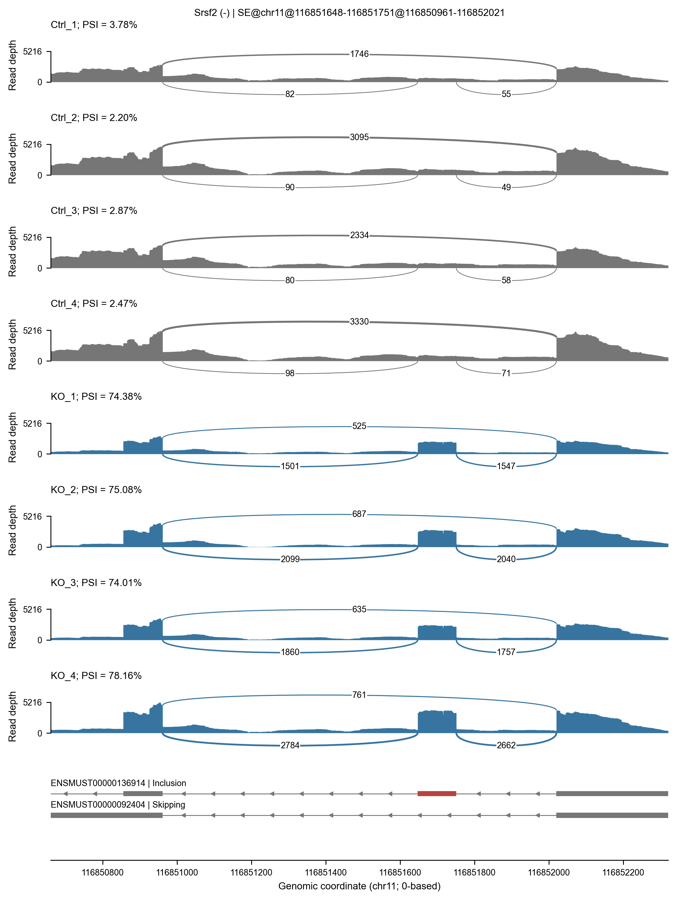
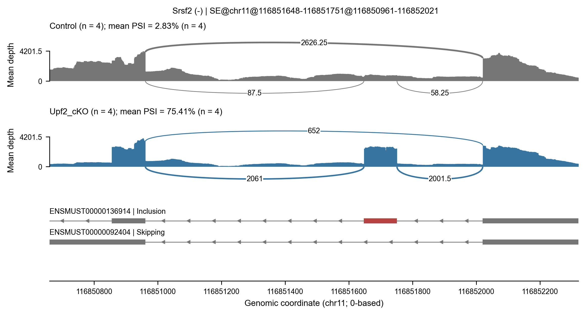

# 🐕 shiba2sashimi 🍣 (v0.2.0)

[](https://github.com/Sika-Zheng-Lab/shiba2sashimi/blob/main/LICENSE)
[](https://doi.org/10.5281/zenodo.15042265)
[](https://github.com/Sika-Zheng-Lab/shiba2sashimi/releases)
[](https://github.com/Sika-Zheng-Lab/shiba2sashimi/releases)
[](https://github.com/Sika-Zheng-Lab/shiba2sashimi/actions/workflows/release.yaml)
[](https://github.com/Sika-Zheng-Lab/shiba2sashimi/actions/workflows/publish.yaml)
[](https://codecov.io/gh/Sika-Zheng-Lab/shiba2sashimi)
[](https://pypi.org/project/shiba2sashimi/)
[](https://pypi.org/project/shiba2sashimi/)
[](https://pypi.org/project/shiba2sashimi/)
[](https://anaconda.org/bioconda/shiba2sashimi)
[](https://anaconda.org/bioconda/shiba2sashimi)
[](https://hub.docker.com/r/naotokubota/shiba2sashimi)
[](https://hub.docker.com/r/naotokubota/shiba2sashimi)
[](https://hub.docker.com/r/naotokubota/shiba2sashimi)

A utility to create Sashimi plots, a publication-quality visualization of RNA-seq data, from [Shiba](https://github.com/Sika-Zheng-Lab/Shiba) output. Greatly inspired by [rmats2sashimiplot](https://github.com/Xinglab/rmats2sashimiplot) and [MISO](https://miso.readthedocs.io/en/fastmiso/sashimi.html)'s original implementation.

## Quick start

```bash
shiba2sashimi -e /path/to/Shiba/experiment_table.tsv \
-s /path/to/Shiba/workdir/ -o img/sashimi_example.png \
--id "SE@chr11@116851648-116851751@116850961-116852021"
```



## How to install

### pip

```bash
pip install shiba2sashimi
```

or

```bash
git clone https://github.com/Sika-Zheng-Lab/shiba2sashimi.git
cd shiba2sashimi
pip install .
```

### conda

```bash
conda create -n shiba2sashimi -c bioconda -c conda-forge shiba2sashimi
conda activate shiba2sashimi
```

### Docker

```bash
docker pull naotokubota/shiba2sashimi
```

## Dependencies

- python (>=3.9)
- numpy (>=1.18.0,<2.0.0)
- matplotlib (>=3.1.0)
- pysam (>=0.22.0)

## Usage

The default is one track per sample. Add `--group-average` to combine replicates
into one track per group:

```bash
shiba2sashimi -e experiment.tsv -s Shiba/workdir -o event.pdf \
  --id "SE@chr11@116851648-116851751@116850961-116852021" \
  --groups control,treatment --group-average --gtf reference.gtf
```

- **Group averages:** arithmetic mean of raw depth and junction counts across all
  selected replicates, including zeros. PSI is the mean of available sample PSI,
  with its valid sample count shown. No library-size normalization is applied.
- **More than two groups:** `--groups control,treatment1,treatment2` selects and
  orders any number of groups in the experiment table. Without `--group-average`,
  it continues to show individual samples.
- **RI boundary counts:** dashed ticks labeled `EI: count` show unspliced
  exon–intron boundary support separately from the spliced junction arc.
  Group tracks show the mean boundary counts across selected replicates.
- **Transcript structures:** exon models and strand arrows appear beneath the
  sashimi tracks, with the selected event highlighted. GTF/GTF.gz can be supplied
  with `--gtf`; assembled Shiba annotation is detected automatically. Without a
  GTF, event-local structures show recorded exons and junctions. Hide them with
  `--no-transcripts`.
- **Shiba v1.0.0:** supports bulk experiment metadata (`technology` and other extra
  columns), Tosa-derived merged counts, missing PSI, and the updated minus-strand
  MXE definition. Legacy bulk output remains supported.
- **Export:** PDF/SVG retain editable text; PNG defaults to 300 dpi. Arial is the
  default font and must be installed, or explicitly select another installed font
  with `--font_family`.

In v0.2.0, coverage is unsmoothed by default and all tracks share a depth scale.
Use `--smoothing_window_size 21` to request the previous median smoothing window.
See [the usage guide](docs/usage.md) for coordinate conventions, aggregation
semantics, compatibility details, and all options (`shiba2sashimi --help`).

### Examples



Group-average sashimi plot with aligned transcript structures.
[Editable SVG](img/group_average_example.svg) ·
[PDF](img/group_average_example.pdf).

[Examples for all eight event types](img/examples/README.md) include individual
sample tracks and group means, each in PNG and PDF.

### Development and tests

```bash
python -m pip install -e '.[test]'
python -m pytest --cov=shiba2sashimi --cov-report=term-missing
```

## Contributing

Thank you for wanting to improve shiba2sashimi! If you have any bugs or questions, feel free to [open an issue](https://github.com/Sika-Zheng-Lab/shiba2sashimi/issues) or pull request.

## Citation

If you use shiba2sashimi in your research, please cite the original Shiba paper:

Kubota N, Chen L, Zheng S. [Shiba: a versatile computational method for systematic identification of differential RNA splicing across platforms](https://academic.oup.com/nar/article/53/4/gkaf098/8042001). *Nucleic Acids Research*  53(4), 2025, gkaf098.

## Authors

- Naoto Kubota ([0000-0003-0612-2300](https://orcid.org/0000-0003-0612-2300))
- Liang Chen ([0000-0001-6164-4553](https://orcid.org/0000-0001-6164-4553))
- Sika Zheng ([0000-0002-0573-4981](https://orcid.org/0000-0002-0573-4981))
