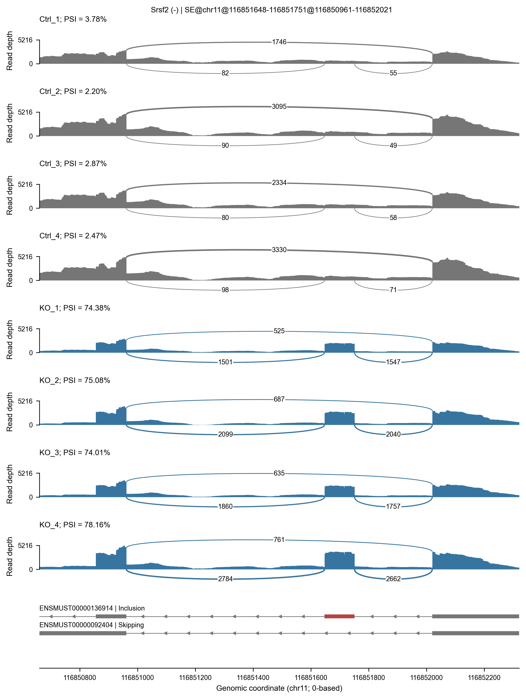

# 🐕 shiba2sashimi 🍣 (v0.2.0)

Here is the documentation page of [shiba2sashimi](https://github.com/Sika-Zheng-Lab/shiba2sashimi), a utility to create Sashimi plots from [Shiba](https://github.com/Sika-Zheng-Lab/Shiba) output. Greatly inspired by [rmats2sashimiplot](https://github.com/Xinglab/rmats2sashimiplot) and [MISO](https://miso.readthedocs.io/en/fastmiso/sashimi.html)'s original implementation.

## Quick start

```bash
shiba2sashimi -e /path/to/Shiba/experiment_table.tsv \
-s /path/to/Shiba/output/ -o img/sashimi_example.png \
--id "SE@chr11@116851648-116851751@116850961-116852021"
```

{ width=80% }

## Contents

- [Installation](installation.md)
- [Usage, group averaging, and transcript structures](usage.md)
