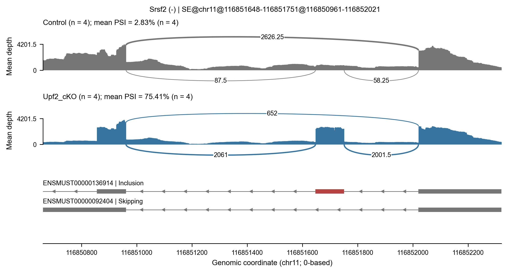
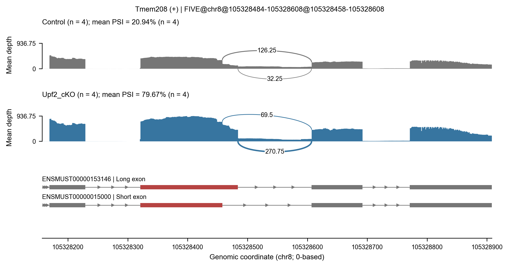
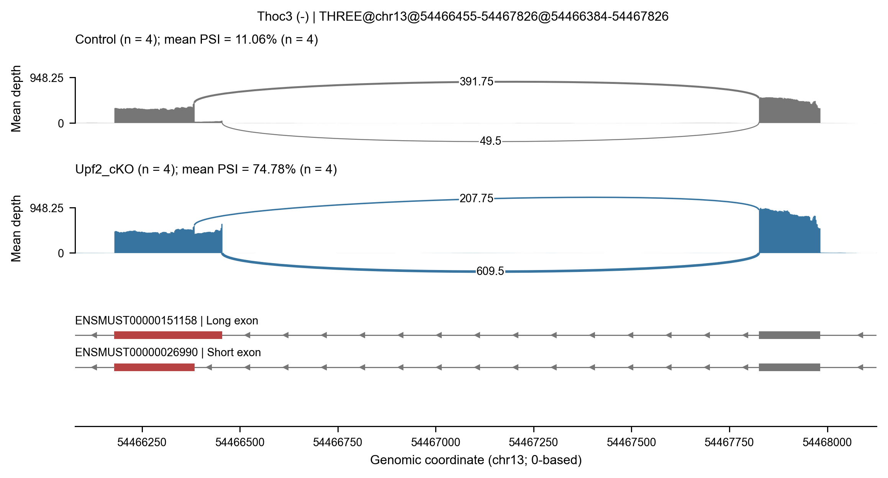
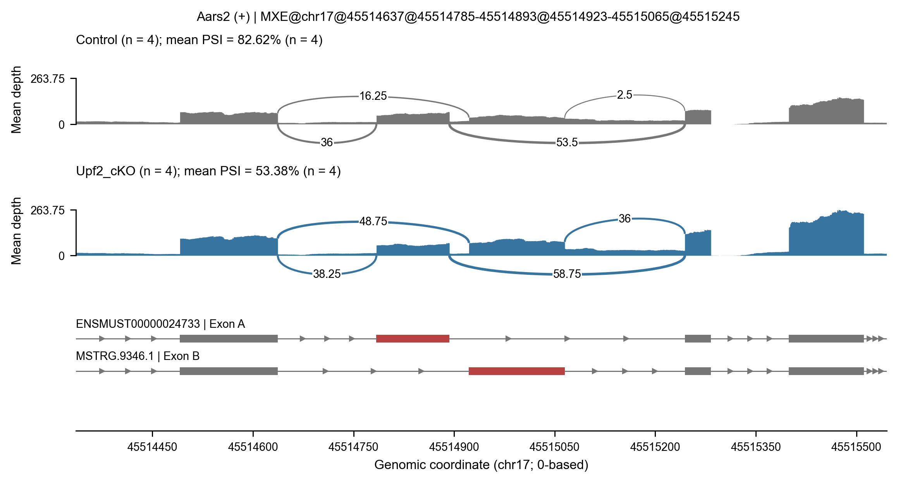
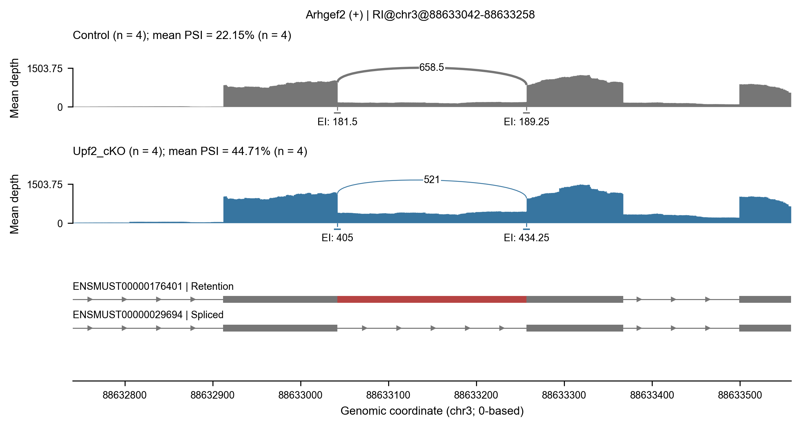
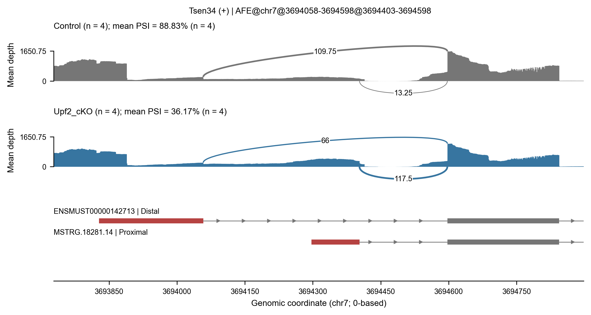
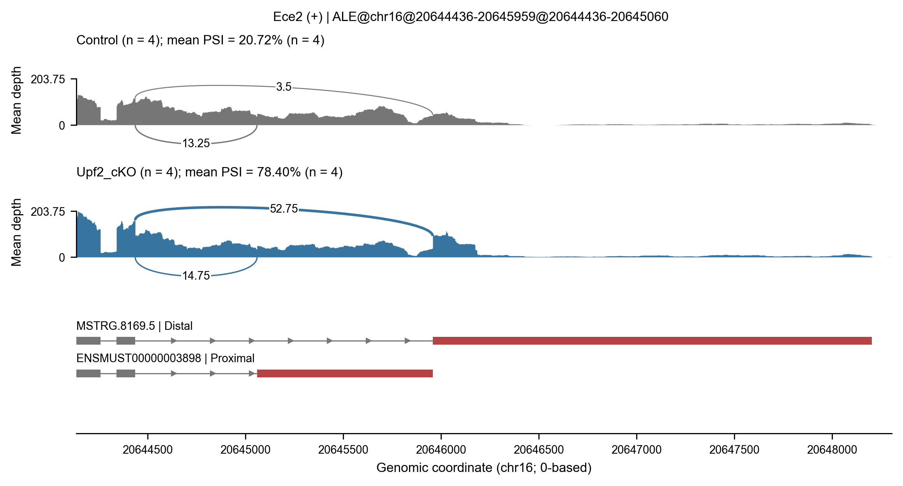
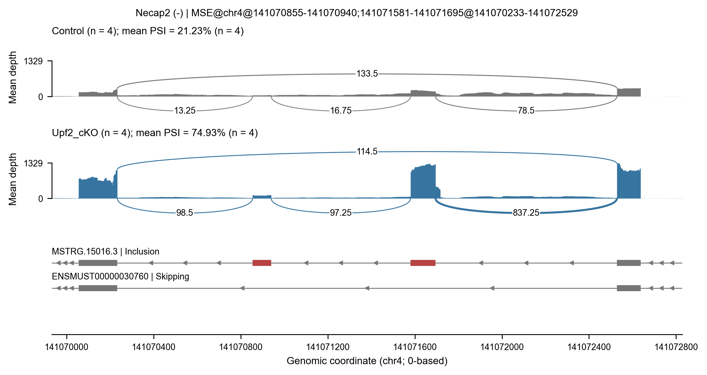

# Example gallery

The Control and Upf2_cKO bulk RNA-seq data used in this gallery were published in [this Cell Reports study](https://www.cell.com/cell-reports/fulltext/S2211-1247%2826%2900105-1).

These examples use bulk RNA-seq results produced with SnakeShiba v0.8.0 and the assembled GTF based on mouse GRCm38 / Ensembl release 102. They demonstrate legacy-output compatibility; they are not a rerun with Shiba v1.0.0.

Each event has an individual-sample plot containing all eight samples (Ctrl_1–Ctrl_4 and KO_1–KO_4) and a group-average plot containing Control and Upf2_cKO (four samples each). PDF files are vector outputs with editable text; PNG previews are 300 dpi.

## Selected events

PSI values below are arithmetic means of the four sample PSI values, expressed as percentages. ΔPSI is Upf2_cKO minus Control in percentage points; it is not the pooled-count group PSI or dPSI reported by Shiba. The original event IDs, q values, per-sample PSI, plotting windows, and transcript IDs are in [events.tsv](events.tsv).

| Type | Gene | Control PSI (%) | Upf2_cKO PSI (%) | ΔPSI (pp) | Individual samples | Group averages |
| --- | --- | ---: | ---: | ---: | --- | --- |
| SE | Srsf2 | 2.83 | 75.41 | +72.58 | [PNG](SE/samples.png) · [PDF](SE/samples.pdf) | [PNG](SE/groups.png) · [PDF](SE/groups.pdf) |
| FIVE | Tmem208 | 20.94 | 79.67 | +58.74 | [PNG](FIVE/samples.png) · [PDF](FIVE/samples.pdf) | [PNG](FIVE/groups.png) · [PDF](FIVE/groups.pdf) |
| THREE | Thoc3 | 11.06 | 74.78 | +63.71 | [PNG](THREE/samples.png) · [PDF](THREE/samples.pdf) | [PNG](THREE/groups.png) · [PDF](THREE/groups.pdf) |
| MXE | Aars2 | 82.62 | 53.38 | -29.24 | [PNG](MXE/samples.png) · [PDF](MXE/samples.pdf) | [PNG](MXE/groups.png) · [PDF](MXE/groups.pdf) |
| RI | Arhgef2 | 22.15 | 44.71 | +22.56 | [PNG](RI/samples.png) · [PDF](RI/samples.pdf) | [PNG](RI/groups.png) · [PDF](RI/groups.pdf) |
| AFE | Tsen34 | 88.83 | 36.17 | -52.66 | [PNG](AFE/samples.png) · [PDF](AFE/samples.pdf) | [PNG](AFE/groups.png) · [PDF](AFE/groups.pdf) |
| ALE | Ece2 | 20.72 | 78.40 | +57.68 | [PNG](ALE/samples.png) · [PDF](ALE/samples.pdf) | [PNG](ALE/groups.png) · [PDF](ALE/groups.pdf) |
| MSE | Necap2 | 21.23 | 74.93 | +53.70 | [PNG](MSE/samples.png) · [PDF](MSE/samples.pdf) | [PNG](MSE/groups.png) · [PDF](MSE/groups.pdf) |

## Selection and interpretation

Events were selected for a clear visual difference between groups, using finite PSI in all eight samples, an original q value ≤ 0.01, an absolute mean PSI difference ≥ 15 percentage points, and non-overlapping sample PSI ranges separated by ≥ 8 percentage points. Among eligible events, readable exon structures, junction support, and compact plotting windows guided the selection. This is an illustrative gallery, not an unbiased sample of differential splicing events.

Read depth and junction counts are raw, without library-size normalization or smoothing. Group tracks show arithmetic means across all four replicates, including zeros. Tracks within each figure share a depth scale, and the sample and group plots use the same genomic window. Axis limits can differ between those two plots because averaging changes the maximum depth. PSI definitions are those of the original run, including its event and strand conventions.

The RI example additionally favors uniform coverage across the retained intron. For the selected Arhgef2 event, all 215 intronic bases (chr3:88633042–88633257, 0-based half-open) have nonzero coverage in every sample. The per-sample coefficient of variation of raw base-level intronic depth (population standard deviation / mean) ranges from 0.066 to 0.126 across the eight samples.

The lower panel shows two representative transcripts from the assembled GTF, matched to the exon and junction structures of the alternative event paths. Reference transcript IDs are preferred when available; MSTRG IDs identify assembled transcripts. Only the displayed genomic window is shown. Red marks the target event, and arrows indicate strand direction. These models illustrate structure, not transcript abundance or the complete set of annotated isoforms.

The source BAMs and example-generation scripts are kept locally and are not distributed in this repository.

For RI, dashed ticks below the coverage baseline mark exon–intron boundaries.
Their `EI: count` labels show unspliced boundary counts (arithmetic means in
group plots); the arc shows the spliced junction count. Count labels use ordinary
decimal notation with up to three decimal places.

## Group-average previews

### SE — Srsf2

### FIVE — Tmem208

### THREE — Thoc3

### MXE — Aars2

### RI — Arhgef2

### AFE — Tsen34

### ALE — Ece2

### MSE — Necap2

